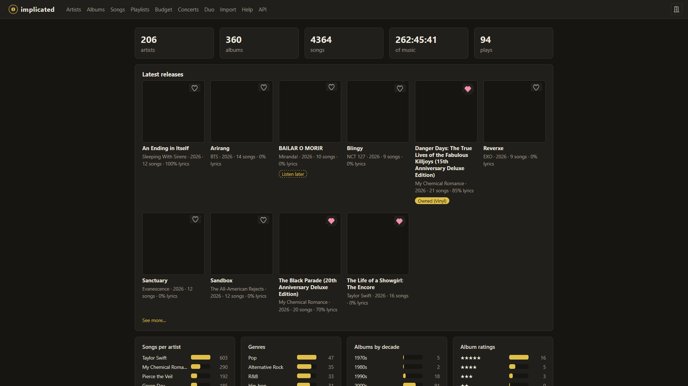

#  implicated

**Your music taste, all in one place.** 🎶

implicated is a personal app for keeping track of the artists, albums and songs you love: read
lyrics, play along with guitar tabs, plan your next record haul and never miss a concert.
Everything lives on your own computer. ✨



## ⚖️ A tracker, not a player

implicated keeps track of your **listening habits and likes**: what you love, what you own and
what you've played. It is not a music player or a music store.

- 🚫 **It does not host, upload or ship any copyrighted material.** The artists, albums, songs,
  covers, lyrics and tabs in your library are the ones **you** provide, from your own sources.
- 🎧 **It does not play your music.** Listen in the apps and services where you have lawful
  access to it, then log your listens here. (Videos you link play in YouTube's own embedded
  player, and the tab player synthesizes the notes of a tab file, not a recording.)

## 🚀 Quick start

```sh
make install   # pip install -e ".[dev]"
make seed      # optional: demo artists, albums, songs and plays
make serve     # http://127.0.0.1:8000
make test      # run the tests with coverage
```

Then open **<http://127.0.0.1:8000>** and enjoy! The JSON API docs are at **`/docs`**.

> [!TIP]
> Click the **implicated logo** at the top left, from any page, to get back to your Overview.

## 🧭 What's inside

| Page | What you can do there |
| --- | --- |
| 📊 **Overview** | See your totals, charts, latest releases, favorites and listen later lists |
| 🎤 **Artists** | Browse artist cards and filter them by origin, genre, language, favorites or listen later |
| 💿 **Albums** | Browse covers, filter by CD or vinyl, and spot missing lyrics or covers |
| 🎵 **Songs** | Search every song, sort it, open its lyrics, tab and videos, and merge the same song on several albums (a deluxe edition, say) so it counts as one |
| 📜 **Playlists** | Build your own, next to the built-in **Favorites** and **Listen Later**, and rank any of them (or an album's or artist's songs) in a **tier list**, then make a playlist of its top levels |
| 🛒 **Budget** | Fill a cart of CDs and vinyls, see what it costs, and save or buy it |
| 🎟️ **Concerts** | Track the shows you want to see and the ones you went to |
| 🔴 **Live Play** | Follow an album or playlist as you listen, lyrics included |
| 👥 **Duo** | Compare your taste with a friend's for recommendations, and download or import your own data |
| 📥 **Import** | Preview and accept a batch of files from the inbox, manage its archives, and download a backup or an export |
| ❓ **Help** | Read how everything works, right inside the app |

> [!NOTE]
> The door button 🚪 at the top right stops the app. After you confirm, it closes the window (when
> the browser allows it; otherwise it says the app stopped) and shuts the `make serve` server down
> gracefully, reloader included. Everything is saved as you go, so **nothing is lost**.

## 🗂️ Where your data lives

**The library is the one source of truth**: everything the app keeps lives in one folder,
`local/`, so a backup is a zip of it. **`info/` is only an inbox** for batches of files you
prepare by hand, imported when you say so.

| What | Where | Change it with |
| --- | --- | --- |
| 🗄️ The library | `local/implicated.db` (SQLite) | `IMPLICATED_DB` |
| 🖼️ Album covers | `local/covers/`, next to the library | |
| 🧑‍🎤 Artist pictures | `local/artists/`, next to the library | |
| 📸 Pictures you saved of artists | `local/pictures/`, next to the library | |
| 📝 Lyrics, timed lyrics, tabs | `local/bands/<artist>/songs/` and `tabs/` | |
| 🎟️ Concerts and tours | `local/concerts.csv`, `local/tours.csv` | |
| 📥 The inbox, and its archives | `info/` and `info/archive/` (git-ignored) | `IMPLICATED_INFO` |

> [!TIP]
> Coming from an older version, where `info/` held the lyrics, tabs and concerts and was imported
> on every start? Run **`make migrate-info`** once: it shows what the YAML files still differ in
> (the library is kept), moves the lyrics, tabs and concerts into `local/`, and archives the rest.

## 📥 Importing a batch of files

Small edits belong in the app. Bigger ones (an artist's whole discography, a list of concerts) are
easier as files: put them in `info/` (or upload them, zipped, on the **Import** page), **preview**
what they would change, and **accept**. Nothing is imported on its own, **not even on startup**, so
what you edit in the app always stays.

```sh
make import-preview  # only show what would change
make import          # show it, and import if you say yes (python -m implicated.importer --yes skips asking)
```

```
info/
  bands.yaml                      # artists: name, uid, origin, creation_year, genres,
                                  #   languages, description, wiki, members
  bands/<artist name>/albums.yaml # album title -> uid, release_year, unreleased: true for
                                  #   scrapped or leaked albums, cover, songs (name, uid,
                                  #   duration, no_lyrics: true for instrumentals, explicit:
                                  #   true for explicit songs, featuring: other artists of
                                  #   bands.yaml on the song)
  bands/<artist name>/band.jpg    # picture of the artist (.jpg, .png, .webp, .avif, ...)
  bands/<artist name>/covers/     # cover images (no GIFs), matched to albums by file name
  bands/<artist name>/songs/      # lyrics, <song title>.txt, and timed lyrics, <song title>.lrc
  bands/<artist name>/tabs/       # guitar tabs, <song title>.gp5 (or .gp, .gpx, .gp4, .gp3)
  concerts.csv, tours.csv         # added to the library's (see Concerts, below)
  userdata.json                   # a Download my data file, applied after the rest
```

- 🧩 **Matching**: records are found by their `uid` (exports carry one on every record, so a
  renamed artist, album or song is still found), or else by name, ignoring case and kinds of dash.
  Anything not found is created.
- ✍️ **A key in the file wins; a key left out keeps what the library has**, so a file only needs
  what it changes. Ratings, notes, favorites, CD and vinyl ownership, videos, listen later marks,
  playlists and plays are never touched by the YAML (`userdata.json` is the way to bring those).
- 🔍 **The preview** lists the new records and every changed field (now → from the file), with the
  warnings. Accept imports exactly what the preview showed: if the inbox changed meanwhile, it asks
  you to preview again.
- 🗃️ **Accepted files move to `info/archive/<when>/`**, so the inbox is empty again and the same
  files are never imported twice. The Import page lists the archives and deletes them, one or all,
  after asking.
- 📄 **Lyrics, timed lyrics and tabs are copied into `local/bands/`**, replacing the library's file
  when theirs has other words; an empty lyrics file in the inbox changes nothing.
- 💥 **A broken file stops the whole import**, which then changes nothing, and is reported.
- 🔗 **`wiki`** must be a link to a Wikipedia article (`https://<lang>.wikipedia.org/wiki/<title>`).
  Any other link is ignored with a warning, and the API and forms refuse it.
- 📖 The **full format** is described in `src/implicated/importer.py`.

## 📦 Backups and exports

| | What's in it | How |
| --- | --- | --- |
| 💾 **Backup** | `local/`, exactly: a snapshot of the database, covers, pictures, lyrics, tabs, concerts, friends | *Download a backup* on the Import page, or `make backup [FILE=...]`. `make restore FILE=...` (app stopped) puts it back, after zipping what was there |
| 📤 **Export** | The library as an **inbox**: YAML with a `uid` on every record, covers, artist pictures (not the saved Pictures: only backups keep those), lyrics, tabs, concerts and `userdata.json` | *Download an export*, or `make export [FILE=...] [OWNER=...]`. Upload it on the Import page, here or in a fresh library, to rebuild it, or unzip it to edit by hand |

Exporting and importing an export gives back the same export. Songs without an album have no place
in `albums.yaml`, so exports leave them out (with a warning).

## 🎸 Lyrics and tabs

### 📝 Lyrics

Lyrics files are named after the song, with `/` turned into `_` and the characters Windows refuses
in file names (`<>:"\|?*`) left out, so `S/C/A/R/E/C/R/O/W` is `S_C_A_R_E_C_R_O_W.txt`.

- 📄 **Every song has a lyrics file** in `local/bands/<artist>/songs/`: the import, the Add song
  forms and the API create an empty one when it is missing, renaming a song renames its file, and
  renaming an artist moves their folder.
- 🔄 **Song pages** read the file again on every visit, with buttons to open it in your default
  text editor (under WSL, the Windows one) and to reload it.
- 🔍 **Missing lyrics are easy to find**: album pages mark those songs, album lists show the share
  of songs that have them, and the Albums and Songs pages can show only what still needs them.
- 🎼 **Instrumentals** have `no_lyrics` (set in `albums.yaml`, or with the No lyrics box when adding
  or editing a song), so they never count as missing.
- 🅴 **Explicit songs** have `explicit` (set in `albums.yaml`, or with the Explicit box when adding
  or editing a song), and show an <kbd>E</kbd> by their title. New or changed lyrics (a `.txt` or
  `.lrc` file) with obvious swearing mark the song as explicit on their own, unless its
  `albums.yaml` entry says `explicit`. Mild words (damn, hell, ass) don't count, and nothing ever
  unmarks a song.

### ⏱️ Timed lyrics

A song can also have an `.lrc` file next to its `.txt`, with the same name. It is a text file with
a timestamp per line, which Live Play follows:

```
[00:12.40]First line
[00:15.10][01:20.00]A chorus, sung twice
[00:18.00]
```

- ⌛ **Stamps** are `[mm:ss]`, with or without hundredths or thousandths. A stamp with no words is an
  instrumental gap, and `[offset:250]` shows every line 250 ms sooner (negative numbers, later).
- 📄 **The `.txt` is optional then**: an empty one takes its words from the `.lrc`, so the song isn't
  missing its lyrics. A `.txt` with words keeps showing on the song page.
- ✏️ *Open lyrics file* opens the `.lrc` when the song has one, and renaming a song renames it too.

### 🎼 Guitar tabs

A song can have a Guitar Pro file in `local/bands/<artist name>/tabs/`, named like the lyrics file but
ending in `.gp5` (or `.gp`, `.gpx`, `.gp4`, `.gp3`).

> [!TIP]
> In TuxGuitar, use **File > Save As** and pick **Guitar Pro 5**: its own `.tg` files cannot be read.

The song page draws the tab as notation and tablature with
[alphaTab](https://www.alphatab.net/) (bundled in `src/implicated/web/static/alphatab/`, MPL-2.0),
can play it back, lets you pick the track when the file holds several, and has buttons to open the
file in TuxGuitar and to reload it after saving.

## 🧭 Browsing your library

- 📊 **Overview lists** show **10 records** at most. When there are more, *See more...* opens the
  full list on the Artists, Albums or Songs page, already filtered.
- 📄 **Long lists come in pages**: 24 artists, 48 albums or 50 songs at a time, with buttons above
  and below the list. Filters and order selectors apply to the whole list, while clicking a column
  header sorts the page in view.
- 🖼️ **Artist cards** show the artist's picture in grey behind the card, when they have one.
- 📸 **Pictures**: an artist page shows the newest pictures you saved of them and links to their
  **Pictures** page, 24 thumbnails at a time. Add one there (AVIF, GIF, JPEG, PNG or WebP) with a
  name (the file's, when left empty), a description and comma-separated tags. Search by name, file
  name, description or tag, or pick a tag. Clicking a thumbnail opens the **Picture** page: the
  image, its name, file name, description and tags (each a link to the pictures with it), and
  buttons to edit or delete it. The API has them under `/api/artists/{id}/pictures` and
  `/api/pictures/{id}`.
- ♡ **Favorites come first** on the Artists and Albums pages and in the Songs page's A–Z order.
  Album tiles have a ♡ to mark them. The Albums page can also go *Newest first*.
- ✏️ **Songs are edited** from album pages, not from the Songs page.
- 🏷️ **Cover tags**: albums without a cover of their own are tagged *no cover* (the ♪ placeholder
  shows instead) or *shared cover* (the same image as another album, say a deluxe edition that
  matched the original's cover file), and the Albums page can show only those.
- 🖼️ **Uploading a cover**: *Set cover* (or *Change cover*) under an album page's cover uploads an
  image right away (AVIF, JPEG, PNG or WebP; not GIF), and the *Add album* form takes one too.
  An import only changes an album's cover when its inbox brings a file for it.

## 🛒 Budget

A cart of CDs and vinyls to buy. Pick a **band** (your favorites come first), then one of its
**albums** (split into *Wanted*, *Neither* and *Owned*), then the **format**, and give its price,
quantity and, optionally, a link to it in a shop.

| Cart field | What it does |
| --- | --- |
| 📦 **Shipping** | Goes **on top** of the total. It is `0.00` until you change it |
| 🏷️ **Discount** | Optional. Comes **off** the total, which never goes below `0.00` |

Both show even while the cart is empty, and both are saved with the budget.

- ⚠️ **Albums you already own** on that format can go in too, but each one is flagged.
- 💾 **Make Budget** saves the cart under a name and empties it.
- 💳 **Buy** marks its albums owned on their formats and keeps it as a bought budget.
- ✏️ **Saved budgets** can be bought, deleted, or loaded back into the cart to edit.
- 🔀 **Buying albums other budgets also hold** (on the same format) first asks whether to drop them
  from those budgets, deleting any budget that leaves empty.

Prices show with a generic `$`, whatever currency the shops charge in. The API has it all under
`/api/budget`.

## 🎟️ Concerts

The page lists the concerts in `local/concerts.csv`, **read again on every visit** (no restart
needed): upcoming ones first, soonest at the top, then past ones. The file is optional, and its
first line names the columns, separated by `;`:

```
date;band;tour;country;city;Want to go;Going
2026-12-09;Sleeping With Sirens;Complete Collapse Tour;Argentina;Buenos Aires;true;true
```

| When | What you set | Saved in the file as |
| --- | --- | --- |
| ⏳ **Upcoming** | **Status**: nothing, *Want to go* or *Going* | Want to go and Going columns |
| ✅ **Past** | **Went**: a box to tick | The same columns (*Going* turns into *Went*) |
| 🎶 **Either** | **Setlist**: one of your playlists, optional | A `Setlist` column with its name |

- ➕ **Add concert** adds one concert to the file, creating it if missing. The tour may be left
  empty in the file, but the form asks for it. A column it needs that the file lacks, such as
  `tour`, is added after `band`.
- 🚌 **Add tour** takes a band and a tour's name and keeps them in `local/tours.csv` (columns
  `band;tour`), so Add concert suggests that band's tours, along with those its concerts already
  name.
- 📋 **The copy button** at the end of a row fills Add concert with that concert, to change what
  differs and add it as a new one.
- 🎶 **Setlists** link a concert to a playlist of the songs played there, picked in its row or in
  Add concert. The `Setlist` column is added at the end of the file the first time one is set.
  Renaming the playlist renames it in the file; a name no playlist has any more is flagged on the
  page, and the playlist page lists the concerts it is the setlist of.
- 🖼️ **Bands in your library** show their picture and link to their page.
- ⚠️ **Rows that cannot be read** are listed on the page.

## 🔴 Live Play

An album page's *▶ Played* button logs a listen of each of its songs. **Live Play**, started with
the button on an album or playlist page (nothing else leads to it), follows the list as you listen
along:

- 👀 **It shows** the cover, song, length, artist and lyrics, with a ♡ and a ⧖ for the song.
- ⏱️ **Timed lyrics** (see above) light up line by line and scroll along, for songs with a length.
  The app plays no sound, so its clock starts when the song comes on here: click a line as you hear
  it to catch up with your music.
- ⏯️ **Its buttons** go to the previous song, pause it, play this one again or go to the next.
- ⏭️ **Songs move on by themselves**: every song that comes on starts playing and logs a listen, and
  when its length has gone by the next one comes on (songs without a length wait for the button).
- ⏸️ **Play/Pause** stops and resumes the song's bar and the wait for the next song.
- 🔒 **The list stays fixed**: reloading the page logs nothing, and the songs stay the same for the
  whole Live Play, even if the playlist changes meanwhile.
- 📌 **The top stays in place** while the lyrics and the song list scroll on their own, except on
  narrow or very short windows, where the page scrolls.

## 💛 Your own data

Besides what the import brings, the app keeps:

- ⭐ **Ratings** of artists, albums and songs, from 1 to 5 stars, set by clicking the stars.
- 📝 **Notes** on artists, albums and songs (artists' notes are separate from their imported
  description).
- 💿 **CD and vinyl ownership** of albums: each format is unset, wanted or owned, picked with a
  selector on the album page and in the artist's discography. The Albums page filters by Wanted
  (CD), Owned (CD), Wanted (Vinyl) and Owned (Vinyl).
- 📺 **YouTube videos**: one music video per song, plus any number of other videos (lessons, covers,
  live takes), each with a title and a start time, in your own order. Song pages embed them.
- 🤝 **Featured artists** of songs ("feat."), picked with Edit details on the song page by
  searching the other artists in the library (each pick becomes a tag; ✕ removes it), or listed under a song's `featuring` in `albums.yaml`. The song page credits them, and each of them lists the song in a
  Songs featured section on their own page.
- 📜 **Playlists** of songs, in your own order. Add songs one by one from their page, several at
  once with the Add songs form at the bottom of the playlist, or a whole album at a time from the
  album page. A song is in a playlist at most once.
- 💖 **Favorites** and ⧖ **Listen Later** are built-in playlists that cannot be renamed or deleted:
  they always hold the songs with that mark, and adding or removing songs sets or clears it.
- ⧖ **Listen later** marks on artists, albums and songs. A song's mark goes away whenever you log a
  play of it, and an album's when you press its ▶ Played button or Live Play reaches its last song.
  An artist's mark only goes away by hand.

<details>
<summary>🔗 <strong>Which YouTube links work?</strong></summary>

Videos are entered as a link or the bare 11-character video id. These are accepted:

- `youtube.com` links (`watch?v=`, `/embed/`, `/shorts/`, `/live/`, `/v/`), also on `m.` and
  `music.`
- `youtu.be` links
- `youtube-nocookie.com` links

Anything else is refused, and only the id (and a `t=` start) is stored.

</details>

### 💾 Exporting and importing it

The **Duo** page downloads all of it, plus your listening history, as one JSON file, and imports
such a file back: to move to another computer, to keep a backup, or to start over from a fresh
database. The same is at `GET /api/data/export` and `POST /api/data/import`, and on the command
line:

```sh
make export-data                   # implicated-<date>.json (OWNER=Sol adds your name to it)
make import-data FILE=my-data.json
```

- 🏷️ **Records go by name**, not by database id: artists by name, albums by artist and title,
  songs by artist, album and title, compared like the import does (ignoring case and kinds of
  dash), so the library needs the records first (an export's `userdata.json` comes after its
  YAML, so importing an export just works).
- 🔁 **Each record in the file is the full picture** of it: its marks, rating, notes, ownership,
  music video, featured artists and videos become the file's. Plays are **added** (never twice
  at the same moment), and playlists are created, or have their songs replaced, by name.
- ⚠️ **Records the library does not have are skipped** and listed after the import, and the ones
  the file does not name stay as they are. A broken file imports nothing.
- 👥 **Made to be compared**: every artist, album and song of the library is in the file, with its
  genres, languages, origin, year and length, and an optional **owner** name, so a friend's file
  makes sense on its own (see Duo, below).

The format is described in `src/implicated/userdata.py`.

## 👥 Duo

Swap data files with a friend: each of you downloads yours on the Duo page, and adds the other's
with **Add friend**. Their file is kept in `local/friends/`, next to the library, and **none of it
goes into your library**. Pick a friend to see a **taste match** (how many of the artists either
of you likes both of you like), the artists and songs you have in common, the genres you share,
and these sections:

| Section | What's in it |
| --- | --- |
| 💞 **You both love** | Artists, albums and songs you both have as favorites |
| ⧖ **Listen later, together** | What's on both your listen later lists |
| 🔁 **Both on repeat** | Songs you have each played 3 times or more |
| ⏩ **Move it up your queue** | Your listen later records your friend loves or plays a lot |
| 🎁 ***Friend* recommends** | Records in your library your friend loves and you haven't played |
| 🔥 ***Friend*'s heavy rotation** | Songs your friend keeps playing that you never played |
| 📣 **Share with *friend*** | Your favorites they haven't played, or don't even have |
| 🔭 **Discover** | Artists and albums your friend loves that aren't in your library |
| 💿 **Swap shelf** | Albums one of you owns on CD or vinyl and the other wants: borrow or lend |

"Loving" a record means a favorite or 4 stars or more, and an album or artist counts as played when
any of its songs was. Records go by name, as in the data import. A section with songs has a button
to make them a playlist (*Sol & me: You both love*), refilled when pressed again. Adding a newer
file under the same name replaces the old one, and *Forget* removes it.

## 🏗️ Project layout

| Path | What's there |
| --- | --- |
| `src/implicated/models.py` | Dataclass models (`Artist`, `Member`, `Album`, `Song`, `SongVideo`, `Play`, `Playlist`, `Picture`, and their `*In` inputs) |
| `src/implicated/library.py` | SQLite storage and stats |
| `src/implicated/importer.py` | Inbox importer (with preview) for artists, members, albums, songs, covers, lyrics, tabs and CSVs |
| `src/implicated/inbox.py` | The inbox: uploads, archives of accepted imports |
| `src/implicated/backup.py` | Backup and restore of `local/`, and exports in the inbox format |
| `src/implicated/migrate.py` | One-time move of an older `info/`'s lyrics, tabs and concerts into `local/` |
| `src/implicated/concerts.py` | Reads and updates `concerts.csv` for the Concerts page |
| `src/implicated/userdata.py` | Exports your own data to a JSON file and imports it back |
| `src/implicated/duo.py` | Keeps friends' data files and compares them with yours for the Duo page |
| `src/implicated/api/` | JSON routes under `/api/...`, one router (and API page tag) per resource |
| `src/implicated/web/` | Server-rendered pages: Jinja2, vendored htmx, plain CSS and a little plain JS, with **no build step** |

## 📜 License

implicated is free software under the **GNU General Public License v3.0**. See [LICENSE](LICENSE). ⭐
